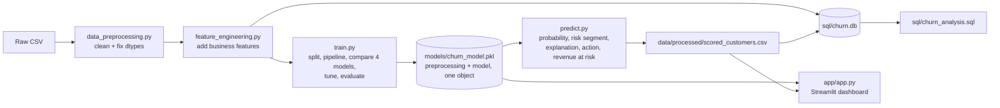

# Customer Churn Prediction System

An end-to-end machine learning system that predicts which telecom customers are likely to churn, estimates *how* likely, explains *why*, and recommends what the retention team should do about it — built as a portfolio-grade, production-style project rather than a single Kaggle notebook.

---

## 1. Project Overview

Subscription and telecom businesses lose recurring revenue every time a customer leaves. This project builds a system that scores every customer's churn risk, segments them into actionable risk tiers, explains the drivers behind each prediction, and estimates the monthly revenue at risk — surfaced through a Streamlit dashboard the retention team could actually use.

## 2. Business Problem

> Which customers are likely to leave, how likely, why, and what should we do about it?

Specifically, the system answers:
- Which customers are high risk, right now?
- What's their individual churn probability?
- Which factors are driving that risk for *this* customer?
- Which customer segments (contract type, tenure, payment method...) churn the most?
- Which customers should the retention team prioritize first?
- What retention action is recommended?

## 3. Objectives

1. Predict churn probability per customer (not just a Yes/No label).
2. Segment customers into Low / Medium / High risk tiers.
3. Explain individual predictions in plain business language.
4. Quantify revenue at risk to prioritize retention spend.
5. Package everything into a reproducible pipeline + interactive dashboard.

## 4. Dataset

**Source:** IBM Telco Customer Churn dataset (`WA_Fn-UseC_-Telco-Customer-Churn.csv`), the widely-used telecom churn dataset mirrored on Kaggle.

All statistics below are computed directly from the file — see `notebooks/01_data_exploration.ipynb` for the full, executed analysis.

| Stat | Value |
|---|---|
| Rows | 7,043 |
| Columns | 21 |
| Target | `Churn` (Yes/No) |
| Churn rate | 26.54% (1,869 churned / 5,174 retained) |
| Duplicate customer IDs | 0 |
| Duplicate rows | 0 |
| Missing values (`.isnull()`) | 0 |
| Hidden data issue | `TotalCharges` stored as text, with **11 blank-string rows** (all `tenure == 0`, i.e. brand-new unbilled customers) |

## 5. Features

- **Numerical:** `tenure`, `MonthlyCharges`, `TotalCharges`
- **Binary categorical:** `gender`, `SeniorCitizen`, `Partner`, `Dependents`, `PhoneService`, `PaperlessBilling`
- **Multi-class categorical:** `MultipleLines`, `InternetService`, `OnlineSecurity`, `OnlineBackup`, `DeviceProtection`, `TechSupport`, `StreamingTV`, `StreamingMovies`, `Contract`, `PaymentMethod`
- **Engineered (see §11):** `TenureGroup`, `MonthlyChargeCategory`, `ServiceCount`, `HasTechSupport`, `HasOnlineSecurity`, `ContractRiskScore`, `IsElectronicCheck`, `CustomerValueSegment`

## 6. Technologies Used

Python · Pandas · NumPy · Matplotlib · Seaborn · Scikit-learn · SQL (SQLite) · Joblib · Streamlit · Jupyter

No unnecessary tooling was added — no XGBoost/SHAP/FastAPI/Docker dependency is required to run the core system (they're listed as optional future improvements in §21, since they weren't installable in this offline build sandbox but are drop-in additions with internet access).

## 7. Project Architecture



## 8. Folder Structure

```
customer-churn-predictor/
├── data/
│   ├── raw/                          # original CSV
│   └── processed/                    # cleaned + feature-engineered + scored data, churn.db
├── notebooks/
│   ├── 01_data_exploration.ipynb
│   ├── 02_eda.ipynb
│   ├── 03_feature_engineering.ipynb
│   └── 04_model_training.ipynb
├── src/
│   ├── data_preprocessing.py
│   ├── feature_engineering.py
│   ├── train.py
│   ├── predict.py
│   └── evaluation.py
├── models/
│   └── churn_model.pkl               # full pipeline: preprocessing + model
├── sql/
│   └── churn_analysis.sql
├── app/
│   └── app.py                        # Streamlit dashboard
├── reports/
│   ├── model_report.md / .json
│   ├── feature_importance.csv
│   └── figures/                      # confusion matrix, ROC, PR curve, importance chart
├── requirements.txt
├── README.md
└── .gitignore
```

## 9. Data Pipeline & Cleaning Decisions

1. **`TotalCharges` dtype bug:** stored as text with 11 blank-string rows. Verified every one has `tenure == 0` → set to `0.0` (structurally correct — new customer, not yet billed) rather than mean/median-imputed.
2. **No duplicates found** → no de-duplication needed.
3. **`customerID` retained** for reporting/lookup but explicitly excluded from the model's feature columns — no predictive value, unique per row.
4. **`SeniorCitizen`** normalized to a readable `Yes/No` label column for EDA while the numeric 0/1 is kept for modeling.

Full logic: `src/data_preprocessing.py`, demonstrated in `notebooks/01_data_exploration.ipynb`.

## 10. EDA Findings

(Full charts in `notebooks/02_eda.ipynb`)

- **Contract type is the clearest lever** — month-to-month customers churn far more than annual/two-year customers.
- **Churn is front-loaded in year one** — risk drops sharply after ~12 months tenure.
- **Price correlates with churn** — churned customers pay more per month on average.
- **Support & security add-ons correlate with retention** — customers without `TechSupport`/`OnlineSecurity` churn substantially more.
- **Payment friction matters** — Electronic check payers churn more than autopay customers.

These are observed associations from the data, not proven causes.

## 11. Feature Engineering

| Feature | Why it helps | Business meaning |
|---|---|---|
| `TenureGroup` | Captures non-linear tenure/churn relationship | Which lifecycle stage a customer is in |
| `MonthlyChargeCategory` | Data-driven (tercile) pricing tier | Flags premium/price-sensitive customers |
| `ServiceCount` | Aggregate engagement signal | Low count = shallow relationship = easy to leave |
| `HasTechSupport` / `HasOnlineSecurity` | Isolates the two strongest service-level signals | Missing these = more friction when issues arise |
| `ContractRiskScore` | Ordinal encoding of commitment level | Shorter commitment = lower switching cost |
| `IsElectronicCheck` | Isolates the highest-risk payment method | Manual payment = more chances to reconsider |
| `CustomerValueSegment` | Tercile of cumulative revenue (`TotalCharges`) | Powers Revenue-at-Risk prioritization |

None of these use the target in their computation — no leakage. Full derivations and validation: `src/feature_engineering.py`, `notebooks/03_feature_engineering.ipynb`.

## 12. Models Tested

Stratified 80/20 train/test split (`random_state=42`), 5-fold stratified cross-validation, `class_weight="balanced"` to address the ~2.8:1 class imbalance (SMOTE was considered but not used — the imbalance is moderate and balanced class weighting is sufficient and avoids synthesizing artificial customer records).

| Model | Accuracy | Precision | Recall | F1 | ROC-AUC | CV ROC-AUC |
|---|---|---|---|---|---|---|
| Logistic Regression | 0.7367 | 0.5026 | 0.7888 | 0.6139 | **0.8424** | 0.8457 ± 0.0113 |
| Decision Tree | 0.7253 | 0.4890 | 0.7701 | 0.5981 | 0.7944 | 0.7853 ± 0.0039 |
| Random Forest | 0.7757 | 0.6000 | 0.4652 | 0.5241 | 0.8182 | 0.8237 ± 0.0106 |
| Gradient Boosting | 0.8020 | 0.6644 | 0.5134 | 0.5792 | 0.8433 | 0.8479 ± 0.0121 |

*(All numbers computed on the held-out test set — see `reports/model_report.md` / `.json`.)*

## 13. Business-Oriented Model Selection

For churn, a **False Negative** (predicted "won't churn" but the customer actually leaves) means the retention team never reaches out — a guaranteed lost customer. A **False Positive** costs only an unnecessary outreach/discount to a happy customer. Missing a churner is more expensive than a false alarm, so the model was selected on:

```
business_score = 0.6 × ROC-AUC + 0.4 × Recall
```

**Selected model: Logistic Regression** — best ROC-AUC (0.8424) among all candidates *and* strong recall (0.7888), despite Gradient Boosting having higher raw accuracy (0.8020). Accuracy alone would have picked the model that misses more actual churners — the wrong choice for this business.

## 14. Hyperparameter Tuning

`RandomizedSearchCV`, 5-fold stratified CV, scoring on ROC-AUC.

- **Best params:** `{'classifier__solver': 'liblinear', 'classifier__C': 0.01}`
- **Best CV ROC-AUC during tuning:** 0.8461
- **Final held-out test performance:** Accuracy 0.7360 · Precision 0.5017 · Recall 0.7914 · F1 0.6141 · **ROC-AUC 0.8404**

## 15. Churn Probability & Risk Segmentation

Every customer gets a continuous probability (not just Yes/No), bucketed into:

| Segment | Probability |
|---|---|
| High Risk | ≥ 0.70 |
| Medium Risk | 0.40 – 0.69 |
| Low Risk | < 0.40 |

**These thresholds are starting defaults, not proven-optimal cutoffs** — they should be validated against actual business costs (cost of outreach vs. cost of a lost customer) and the precision/recall trade-off (`reports/figures/pr_curve.png`) before being treated as final.

## 16. Explainable AI

No SHAP library was available in this offline build sandbox (no internet access to install it here). Rather than fabricate SHAP-style numbers, `src/predict.py` implements a real, honest alternative:

- **Selected model is linear (Logistic Regression)** → each customer's risk factors are the **exact local contribution** = `coefficient × standardized feature value` — mathematically exact, not approximated.
- **If a tree-based model is ever selected instead**, the code falls back to intersecting the model's global `feature_importances_` with rule-based flags the specific customer triggers (clearly weaker than SHAP, and labeled as such in the output).

The code is structured so a real SHAP explainer (`shap.Explainer(pipe.named_steps["classifier"], ...)`) is a drop-in addition once `shap` is installed — see §21.

## 17. Feature Importance

Top drivers (`reports/feature_importance.csv`, `reports/figures/feature_importance.png`): `ContractRiskScore`, `tenure`, `MonthlyCharges`, `InternetService_Fiber optic`, `TenureGroup_0-12`, `PaperlessBilling`, `Contract` categories, `IsElectronicCheck`.

**Feature importance is not causation.** It reflects what the model relies on to predict, not a proven causal driver of churn — see the correlation-vs-importance comparison in `notebooks/04_model_training.ipynb`.

## 18. SQL Analysis

`sql/churn_analysis.sql` — 10+ business queries (total customers, churn rate, churn by contract/payment/internet service, high-value customers at risk, high-risk customers, avg charges by churn status, ranked high-probability customers via `CTE` + `RANK() OVER`, revenue-at-risk aggregation). **Every query has been executed against a real SQLite database built from the processed data** (`data/processed/churn.db`) and verified to return correct results — not illustrative placeholders.

## 19. Dashboard

`app/app.py` — Streamlit, 5 pages:

1. **Executive Overview** — total customers, churn rate, high-risk count, avg. probability, revenue at risk
2. **Customer Risk** — search a customer, see probability/segment/risk factors/action
3. **Churn Analytics** — churn by contract/tenure/payment method, top drivers
4. **Prediction** — input form for a hypothetical new customer → live prediction
5. **Model Evaluation** — accuracy/precision/recall/F1/ROC-AUC in plain language, confusion matrix, ROC & PR curves, full model comparison table

## 20. Business Recommendations (rule-based, not model-learned)

| Condition | Suggested Action |
|---|---|
| High risk + month-to-month contract | Offer discounted annual/two-year contract |
| High risk + high monthly charges | Offer personalized pricing / plan review |
| High risk + no tech support | Offer free/discounted tech support trial |
| High risk + short tenure | Onboarding check-in / early-tenure retention incentive |
| High risk + electronic check payment | Encourage autopay switch with a small incentive |

These are business rules layered on top of the model's prediction — the ML model itself only outputs a probability; it does not "know" these actions.

## 21. Revenue at Risk

```
Revenue at Risk = Monthly Charges × Churn Probability
```

Aggregated across all customers: **≈ $213,631 / month** in probability-weighted exposure (`data/processed/scored_customers.csv`). This is an **expected-value estimate**, not guaranteed lost revenue.

## 22. Limitations

- Trained on a single historical snapshot (no temporal/seasonal signal).
- Risk thresholds (0.70 / 0.40) are defaults pending business-cost validation.
- Explainability uses exact linear coefficients (not SHAP) due to offline build constraints — see §16.
- No probability calibration (`CalibratedClassifierCV`) applied yet.
- Dataset reflects one telecom's customer base; not guaranteed to generalize to other industries.

## 23. Future Improvements

- SHAP-based explanations (drop-in once `pip install shap` is available)
- XGBoost as an additional candidate model
- Probability calibration + formal threshold optimization against business cost
- FastAPI serving layer + Docker packaging
- Data drift monitoring / model monitoring concept
- Unit tests + CI/CD

## 24. Business Impact

At a 26.5% baseline churn rate and ~$213.6K/month in probability-weighted revenue exposure, even modest improvements in retention targeting (catching 79% of actual churners per the recall above, vs. contacting customers essentially at random) represent meaningful, defensible revenue protection — while the risk segmentation and suggested actions give the retention team a concrete, prioritized worklist instead of a raw probability number.

---

## How to Run

### 1. Setup
```bash
git clone <this-repo>
cd customer-churn-predictor
python -m venv venv && source venv/bin/activate   # or venv\Scripts\activate on Windows
pip install -r requirements.txt
```

### 2. Dataset
The raw CSV is already included at `data/raw/WA_Fn-UseC_-Telco-Customer-Churn.csv`. To use a fresh copy, download the "Telco Customer Churn" dataset and place it at that path with the same filename.

### 3. Train the model
```bash
python src/train.py
```
This cleans the data, engineers features, trains & compares 4 models, tunes the winner, and saves `models/churn_model.pkl` plus all reports/figures.

### 4. Score all customers
```bash
python src/predict.py
```
Produces `data/processed/scored_customers.csv` with probability, risk segment, explanation, and suggested action per customer.

### 5. Run the dashboard
```bash
streamlit run app/app.py
```

### 6. Explore the notebooks
```bash
jupyter notebook notebooks/
```

---

## Author

Built as a portfolio project demonstrating an end-to-end, production-style ML system — data cleaning, leakage-safe pipelines, business-informed model selection, explainability, SQL analysis, and a deployable dashboard.
